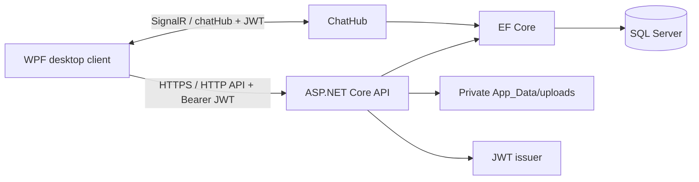
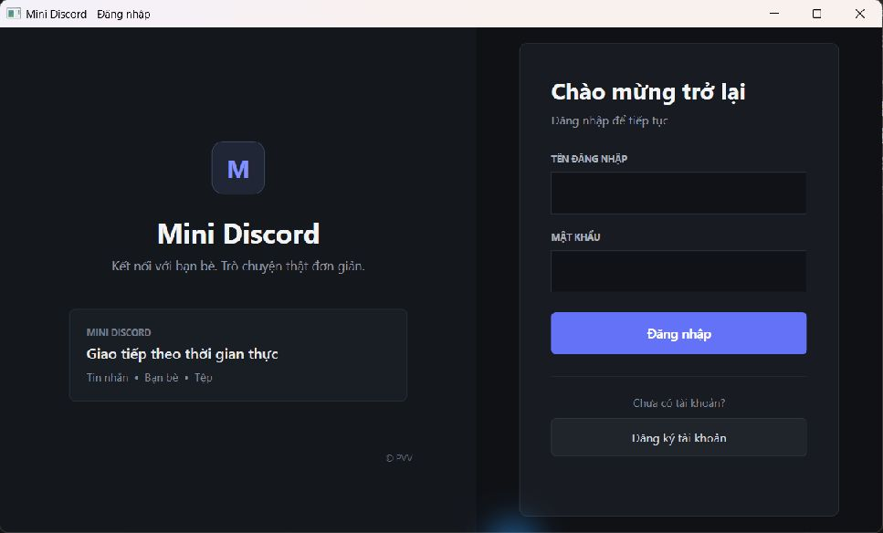
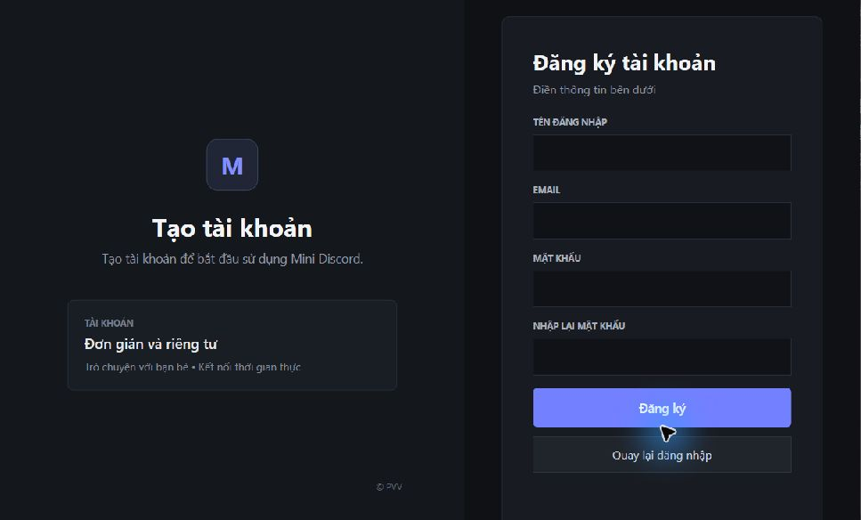

# Mini Discord — Real-Time Desktop Chat

<p align="center">
  
  
  
  <a href="https://github.com/superspecial95/Chatting/actions/workflows/build-and-test.yml"></a>
</p>

Mini Discord is a learning-focused desktop chat application built to demonstrate a complete .NET workflow: a WPF client, an ASP.NET Core API, JWT authentication, SignalR real-time messaging, EF Core, and SQL Server.

> This is a portfolio project, not a production service. Its documented limitations are intentional discussion points for a junior .NET interview.

## Highlights

- Register and sign in with BCrypt password hashing and JWT authentication.
- Send, accept, and reject friend requests; users can message only accepted friends.
- Exchange direct messages in real time through SignalR.
- View the latest 50 messages in chronological order, mark messages as read, and see unread counts.
- Show friend online/offline state while correctly handling more than one client window per account.
- Upload and share approved images, documents, audio, and ZIP files up to 25 MB.
- Record a WAV voice message using the WPF client.
- Store uploaded files outside `wwwroot`; only the sender and receiver of a message can download them.
- Run xUnit unit and HTTP/SignalR integration tests for authentication, friendship, messaging, and file access.

## Architecture



For the component responsibilities and request flows, see [the architecture notes](docs/ARCHITECTURE.md).

## Screenshots

These are captures of the running WPF client with empty forms and no personal chat data. The chat screen still needs a screenshot from a deliberate demo session with test accounts.

| Login | Registration |
| --- | --- |
|  |  |

## Tech stack

| Area | Technology |
| --- | --- |
| Client | WPF, .NET 10, SignalR Client, NAudio |
| Server | ASP.NET Core Web API, SignalR, JWT Bearer |
| Data | Entity Framework Core, SQL Server |
| Security | BCrypt, authorization policies, private file delivery |
| Tests | xUnit, WebApplicationFactory, EF Core InMemory |

## Run locally

### Prerequisites

- Windows 10/11
- .NET 10 SDK
- SQL Server, SQL Server Express, or LocalDB

### 1. Configure local secrets

Secrets are deliberately not stored in `appsettings.json`. From the repository root, set them with User Secrets. This example uses a local default SQL Server instance and a database named `ChatDB`; change the server and database names to match your installation:

```powershell
dotnet user-secrets set --project ChatServer\ChatServer.csproj "ConnectionStrings:DefaultConnection" "Server=localhost;Database=ChatDB;Trusted_Connection=True;TrustServerCertificate=True;"
dotnet user-secrets set --project ChatServer\ChatServer.csproj "Jwt:Key" "replace-this-with-a-random-secret-at-least-32-characters-long"
```

For LocalDB instead, use `Server=(localdb)\MSSQLLocalDB;Database=MiniDiscordDb;Trusted_Connection=True;TrustServerCertificate=True;`. SQL Server and LocalDB are different instances; SSMS must connect to the one in the configured connection string. `TrustServerCertificate=True` is for local development only.

`ChatServer/appsettings.example.json` documents the expected settings. For a deployed environment, use environment variables such as `ConnectionStrings__DefaultConnection` and `Jwt__Key` instead.

### 2. Create or upgrade the database

Run these commands from the repository root. In Command Prompt (CMD), use `cd /d <repository-path>` to change both the drive and directory; plain `cd` does not switch drives.

```powershell
dotnet ef --version
dotnet ef database update --project ChatServer\ChatServer.csproj --startup-project ChatServer\ChatServer.csproj
```

If `dotnet ef --version` works, the tool is already installed. Install it only when it is missing with `dotnet tool install --global dotnet-ef --version 10.0.13`.

The latest migration creates private upload metadata and adds database indexes/constraints. Back up any existing database before applying schema migrations. Existing usernames and emails must be unique before this migration can apply; resolve duplicates deliberately rather than deleting accounts.

### 3. Start the server

```powershell
cd ChatServer
dotnet run --launch-profile http
```

The default local URL is `http://localhost:5291`.

### 4. Start the desktop client

In another PowerShell window:

```powershell
cd ChatClient
dotnet run
```

To point the client at a different server, set the URL for that terminal session before starting it:

```powershell
$env:MINIDISCORD_SERVER_URL = "https://example-server:7255"
dotnet run
```

The client does not bypass TLS certificate validation. For HTTPS development, trust the local development certificate or configure a certificate trusted by the client machine.

## Test

```powershell
dotnet test ChatServer.Tests\ChatServer.Tests.csproj
```

The automated suite covers friendship and presence rules plus real HTTP/SignalR requests using isolated in-memory test data; it does not touch your configured `ChatDB`. It does not yet validate SQL Server-specific migration or constraint behavior. The manual regression checklist is in [docs/TEST_PLAN.md](docs/TEST_PLAN.md). The included GitHub Actions workflow is configured to run the tests and build the Windows WPF client on each push or pull request after this project is pushed to GitHub.

For CV wording and interview preparation, see [docs/CV_EN.md](docs/CV_EN.md). Add real application screenshots only after checking that no personal chat content or credentials are visible.

## Security choices

- JWTs validate the signing key, issuer, audience, and expiry. SignalR reads a bearer token only for `/chatHub` connections.
- The server, rather than the WPF UI, validates registration input, authentication, friendship, message length, and upload limits.
- Message history and read status are unavailable unless the two accounts are accepted friends.
- A user can attach only a file they uploaded themselves. The server persists the attachment URL; the client never fetches arbitrary URLs supplied in chat data.
- New uploads are allow-listed by extension and stored outside `wwwroot`. Old attachments can remain in `wwwroot/uploads`, but the server blocks the public `/uploads` path and serves them only to message participants through `/api/Files/legacy/{storedFileName}`. These local files are ignored by Git, so restoring an old database also requires restoring its attachment files.

## Known limitations / next improvements

- No refresh-token or logout-revocation mechanism yet.
- Uploads are extension allow-listed but do not have anti-virus or MIME-content scanning.
- Chat history currently has a fixed 50-message window; cursor pagination would be the next API improvement.
- There is no unfriend, message deletion, rate limiting, or audit logging yet.
- The project still needs integration tests against a disposable SQL Server database and WPF UI automation for end-to-end coverage.

## Interview talking points

- Why authorization must be enforced in the SignalR hub and API, not only hidden in the UI.
- How multiple browser/app connections can make a naive online-status implementation incorrect.
- Why attachments should live outside public static-file folders and be authorized per message participant.
- How unique indexes complement application-level duplicate checks under concurrent requests.

## Repository hygiene

Do not commit database credentials, JWT keys, build output, runtime uploads, or sample files containing real user data. The provided `.gitignore` excludes these items.
