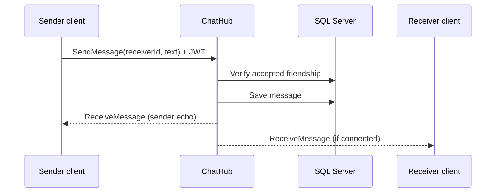
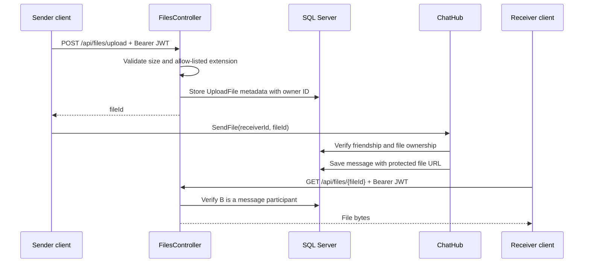

# Architecture notes

## Components

| Component | Responsibility |
| --- | --- |
| `ChatClient` | WPF views, user input validation, authenticated HTTP requests, SignalR subscription, and voice recording/playback. |
| `ChatServer` controllers | Registration, login, friend workflow, message history/read status, and private upload/download endpoints. |
| `ChatHub` | Authenticated real-time delivery of text and attachments, plus online-presence events. |
| `AppDbContext` | EF Core mapping for users, friend requests, messages, and upload metadata. |
| SQL Server | Persistent chat and relationship data. |
| `App_Data/uploads` | Private physical attachment storage, outside the public web root. |
| `wwwroot/uploads` | Legacy local attachments only; the public URL is blocked, and the API permits download only to message participants. |

## Message flow

## Attachment flow

## Data access rules

- A user can read a conversation only with an accepted friend.
- A hub caller can send text or a file only to an accepted friend.
- An attachment can be downloaded only by a sender or recipient of a message referencing that attachment.
- A file ID is owned by the account that uploaded it; the hub rejects attachment spoofing.

## Design trade-offs

The project retains a simple `FriendRequest` entity with a string status. Future refinements could use an enum, foreign keys/navigation properties, unique canonical friendship pairs, transactions, and database constraints for every relationship invariant.
